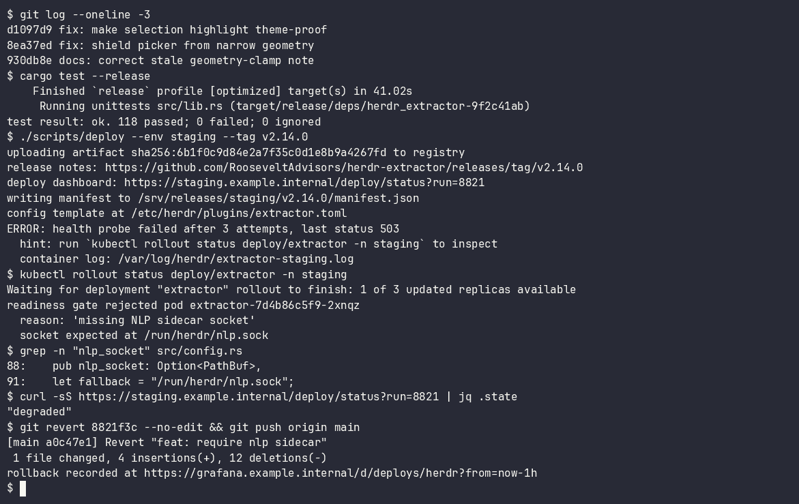
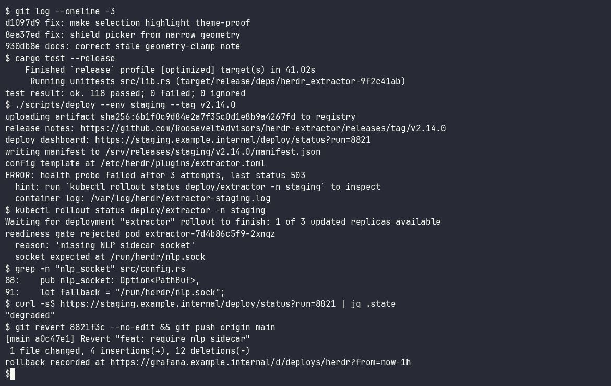
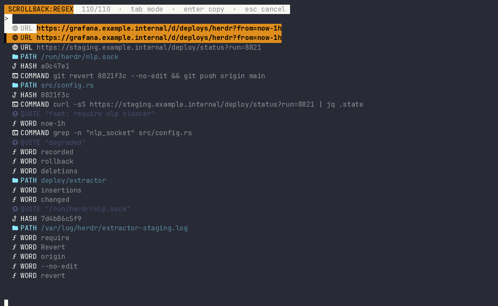
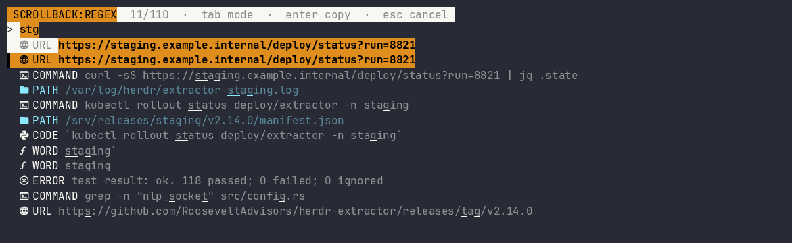
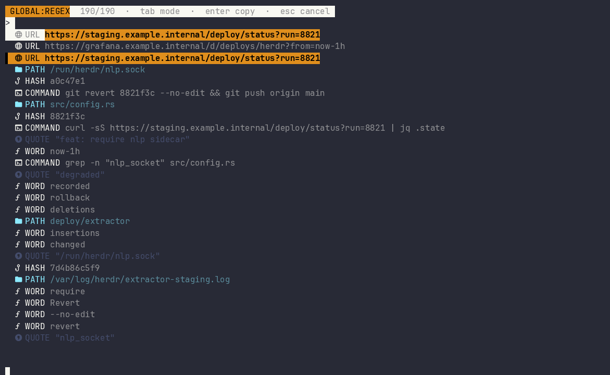

# herdr-extractor

A [Herdr](https://herdr.dev) plugin that lists copy-eligible tokens from the focused pane's
retained **scrollback** and filters them with typeahead.

## Demo

Every copy-eligible token in the focused pane, one keystroke away. Type to narrow, `Enter` to copy.



These demo assets show an earlier layout with synthetic scrollback. The current picker places matches directly below the query.
The detail preview now sits below the list. The closing `copied → …` line comes from the plugin's state log.

**1 · The scrollback the picker reads.** An ordinary working pane: deploy output, a failing health
probe, config paths, an artifact hash, quoted failure reasons.



**2 · `prefix+space` — every token, typed and ranked.** 110 candidates pulled out of that pane, each
tagged with its semantic kind (`URL`, `PATH`, `HASH`, `COMMAND`, `QUOTE`, `WORD`) and its own color
and glyph. The selected row is marked by a full-width highlight that survives any terminal theme.



**3 · Fuzzy typeahead, in-house.** `stg` is a subsequence, not a substring — it reaches
`/srv/releases/staging/…` and `https://staging.example.internal/…` alike. Matched characters are
underlined in place. The current detail preview wraps below the list, with an ellipsis when its four-row limit hides content.



**4 · Global scope reads the whole session.** Cycle past Screen with `Tab` or `Ctrl-G`. Scrollback mode reads the pane's retained scrollback;
global mode reads the pane's full saved session history — here 190 tokens instead of 110, including
lines that scrolled past Herdr's 1000-line `pane.read` cap. The badge in the header always names the
active mode, and the filter query survives the toggle.



## Lineage and credit

This workflow follows [laktak/extrakto](https://github.com/laktak/extrakto), “quickly select,
copy/insert/complete text without a mouse.” This Herdr port is not presented as an original UX
invention. It adapts extrakto's token-picking lineage to Herdr's scrollback and OSC 52 APIs.

## Actions

One picker provides three scopes:

| Action | Default key | Reads |
| --- | --- | --- |
| `RooseveltAdvisors.herdr-extractor.extract` | `prefix+space` | Retained scrollback. `Tab` cycles through Screen and Global scopes |
| `RooseveltAdvisors.herdr-extractor.extract_transcript` | optional (for example `prefix+shift+space`) | The pane's full retained session transcript, opening the picker straight in global mode |

### In-menu mode toggle (`Tab`)

Press `Tab` or `Ctrl-G` inside the picker to cycle through three scopes:

- **scrollback mode** (`SCROLLBACK` in the header): the focused pane's retained
  scrollback, as always.
- **screen mode** (`SCREEN` in the header): only the current visible viewport.
- **global mode** (`GLOBAL` in the header): the pane's full saved session history, the same transcript-grade
  coverage the `extract_transcript` action provides. When Herdr saves pane history
  (`experimental.pane_history = true`, default off) this reads every retained line from
  `session-history.json`; otherwise it falls back to the server-capped 1000-line
  `recent_unwrapped` transcript and the coverage note explains the limit.

Toggling re-extracts live and keeps the current filter query and selection where possible. The
active mode is always visible in the top header, and the hint text names the toggle
(`tab scope`). Successful scope changes clear marks. Failed reads preserve the old scope, results, selection, and marks.

The header shows editing mode, scope, engine, and counts. Each result has a colored kind chip and a selection marker.
Matches begin directly below the query. Query edits select the best match again.
The lower detail preview uses up to four rows. An ellipsis marks hidden content, but copying retains the complete value.
The picker reserves three bottom rows for Herdr chrome when space allows. Short layouts preserve the query prompt.

Search uses smart-case, fzf-style scoring without an external `fzf` executable. Exact and prefix matches receive higher ranking.
Space-separated words match in any order. If no result matches every word, partial matches appear with a `RELAXED: ANY WORD` badge.
Unicode comparisons use lowercasing, not full case folding. Display and editing preserve grapheme clusters, including accents and emoji.

### Editing and help

The picker opens in Insert mode. `Esc` enters Normal mode, and typed `jj` does the same.
Bracketed paste inserts literal text in Insert mode, so pasted `?` and `jj` do not execute commands.
The picker replaces pasted line breaks and tabs with spaces. Normal mode ignores pasted text.

- `j/k` or arrows move through results. `gg/G` select the first or last result.
- `i/a/I/A` or `/` return to Insert mode. `w/b/e`, `0/$`, and `x/X` edit the query in Normal mode.
- `dd` or `D` clears the query. These are limited Vim-like bindings, not a complete Vim editor.
- `Space` marks results in Normal mode. `Enter` copies marks in original result order, separated by newlines.
- `Ctrl-D` pages down. `Ctrl-U` pages up in Normal mode and clears the query in Insert mode.
- `Ctrl-K/Ctrl-J` cycle kind filters. Explicit prefixes include `kind:url`, `u:`, and `p:`. Bare single letters remain search text.
- `?` opens help. `/` searches help, and `j/k` navigate outside help search. Help search has its own visible caret.
- In help search, the first `Esc` stops editing. The next `Esc` closes help and restores the previous editing mode.
- In Normal mode, `Esc` clears an active query or kind filter. With no filter, `Esc` closes the picker. `Ctrl-C` always closes it.

### Scrollback extract (`prefix+space`)

`RooseveltAdvisors.herdr-extractor.extract` opens the `extract` overlay entrypoint.

1. The plugin calls `pane.read` with `source = "recent_unwrapped"` and requests the maximum line
   bound when that parameter is supported, so text found while reading copy mode remains available
   after returning to normal mode. Older Herdr versions fall back to `recent`, then `visible`, only
   when a source is unsupported.
2. Herdr supplies logical lines for `recent_unwrapped`; fallback sources use the pane layout width.
3. A multi-pass extractor collects copy-eligible tokens:
   - pattern filters: URLs (including markdown links), paths, emails, IPv4/IPv6, UUIDs, hostnames,
     ticket/bead/issue ids, env vars, double/single quotes, commands, hashes, versions, error
     lines, backtick/JSON code, title-case phrases, and words of at least five characters
   - built-in entity resolver (`src/entity.rs`): pattern NER plus multi-token phrase chunking and
     a small linear scorer with baked-in weights for entity-name worthiness and kind resolution
   ANSI/SGR residue, box fragments, ratios, percentages, punctuation tails, and wrapped slivers
   are discarded. Canonicalized duplicates collapse to one item, ranked by recency, semantic
   usefulness, length, and character variety.
4. Type to filter. `Up`/`Down` or `Ctrl-P`/`Ctrl-N` moves selection. `Tab` cycles Scrollback, Screen, and Global scopes.
   `Enter` copies the selected item or marked items through OSC 52. `Esc` follows the editing-mode rules above. `Ctrl-C` cancels.

### Session transcript extract (`extract_transcript`)

`RooseveltAdvisors.herdr-extractor.extract_transcript` opens the `extract-transcript` overlay
entrypoint and reads the whole retained session transcript, not just the current viewport. It
starts the picker straight in global mode; inside the picker it behaves exactly like the
`prefix+space` picker after cycling to Global scope. Keep the binding only if you want a
shortcut that lands directly in global mode - the in-menu toggle covers the same data.

- The transcript source covers the whole retained session. When Herdr saves pane history
  (`experimental.pane_history = true` in the herdr config, default off), the extractor reads the
  pane's full saved transcript from `session-history.json` in the session data directory - every
  retained line, including content older than the API cap. Otherwise it reads `pane.read` with
  `source = "recent_unwrapped"`; the server caps that at 1000 logical lines, so a transcript log
  records a `transcript_note` naming the covered line count and, if toasts are enabled, raises a
  notification saying `experimental.pane_history = true` unlocks full-session coverage. Retention
  itself is bounded by `advanced.scrollback_limit_bytes`.
- The transcript read never degrades to viewport-shaped sources. On a Herdr without
  `recent_unwrapped` it fails instead of silently pretending the viewport is the session.
- Herdr alt-screen panes do not keep host scrollback. When `pane.get` reports no retained history
  (`scroll.max_offset_from_bottom = 0`), the picker still opens with the viewport content but logs
  `transcript_note` and, if toasts are enabled, raises a notification saying the pane keeps no host
  scrollback. It never presents viewport-only results as the session transcript.

Typeahead, selection, and OSC 52 copy behave exactly like the scrollback extract.

## Install

```bash
herdr plugin install RooseveltAdvisors/herdr-extractor
herdr server reload-config
```

```toml
[[keys.command]]
key = "prefix+space"
type = "plugin_action"
command = "RooseveltAdvisors.herdr-extractor.extract"
description = "extract a scrollback token"

# Optional: land directly in global (full session history) mode. The Tab
# toggle inside the extract picker reaches the same data without this binding.
[[keys.command]]
key = "prefix+shift+space"
type = "plugin_action"
command = "RooseveltAdvisors.herdr-extractor.extract_transcript"
description = "extract a token from the session transcript"
```

Copy mode is for READING; `prefix+space` is for TAKING. Scroll through pane output with copy mode,
exit to normal mode, then invoke `RooseveltAdvisors.herdr-extractor.extract` with `prefix+space`.
The picker searches retained scrollback and copies the chosen result through OSC 52, so it reaches
the outer terminal clipboard (including the captain's Mac). When the token may sit far above the
current viewport, cycle to Global with `Tab` inside the picker and search the pane's
full saved session history.

This action moved out of `RooseveltAdvisors.herdr-leap` in the public plugin split. Do not bind
`prefix+space` to `RooseveltAdvisors.herdr-leap.open`; that opens the separate jump workflow.

The launcher validates `HERDR_BIN_PATH` and falls back to `herdr` on `PATH`, covering a replaced
Linux server executable whose stale path ends in ` (deleted)`.

## Configuration

Create `config.toml` under `herdr plugin config-dir RooseveltAdvisors.herdr-extractor`:

```toml
copy_toast = true
icons = false

[style]
# Catppuccin Mocha-inspired defaults (hex). Override any key.
selected_match_fg = "#11111b"
selected_match_bg = "#fab387"
status_fg = "#cdd6f4"
status_bg = "#313244"
match_fg = "#fab387"
url_fg = "#89b4fa"
path_fg = "#a6e3a1"
error_fg = "#f38ba8"
command_fg = "#fab387"
hash_fg = "#94e2d5"
version_fg = "#f9e2af"
quote_fg = "#7f849c"
code_fg = "#94e2d5"
email_fg = "#cba6f7"
ip_fg = "#74c7ec"
uuid_fg = "#b4befe"
host_fg = "#89dceb"
id_fg = "#f9e2af"
env_fg = "#a6e3a1"
phrase_fg = "#f5c2e7"
date_fg = "#74c7ec"
color_fg = "#cba6f7"

[nlp]
# Optional external sidecar. Built-in entity resolution always runs in-process.
enabled = false
engine = "sidecar"   # off | sidecar | auto
socket_path = "/run/user/1000/herdr-extractor-nlp.sock"
confidence_threshold = 0.75
```

Named colors and `#RRGGBB` are supported. The existing style settings remain valid; the semantic
foreground settings only affect unselected rows. `icons` may also be set through the environment
with `HERDR_EXTRACTOR_ASCII_ICONS=1`.

### Built-in entity resolver

Every extraction runs a compact in-process entity model (`src/entity.rs`) with no download and no
extra process:

- pattern NER for `email`, `ip`, `uuid`, `host`, `id`, `env`, and bare `www.` URLs
- multi-token phrase chunking for title-case names (`Jon Roosevelt`, `Covenant Clinics`) and
  connector phrases (`Board of Directors`)
- a linear feature scorer with baked-in weights for phrase worthiness and kind resolution when
  several classes compete

Stable kind keys shown in the picker: `url`, `path`, `quote`, `squote`, `word`, `command`, `hash`,
`version`, `error`, `code`, `email`, `ip`, `uuid`, `host`, `id`, `env`, `phrase`, `date`, `color`.

### Optional NLP sidecar contract

For heavier external models (spaCy, transformers, ONNX), enable the Unix-socket sidecar. When
`[nlp].enabled = true` (or `engine = "sidecar"` / `"auto"`), the plugin connects to the configured
socket for each extraction with one 180ms budget shared across connection, writes, and reads. If `socket_path` is omitted it uses
`HERDR_NLP_SOCKET_PATH`, then `nlp.sock` under the plugin config directory. `engine = "auto"` only
dials when the socket path already exists. A connection, timeout, or protocol error is logged and
the built-in list is kept. Tab mode switches repeat the same bounded request, and the header
reports `NLP` only after a sidecar request succeeds.

The protocol requires one newline-terminated JSON request and response per connection. Responses must declare integer version `1`.
The response limit is 1 MiB, including the newline. Candidate confidence must be finite and within `0..1`.
Protocol errors retain the built-in results and record a fallback reason.

Request:

```json
{"version":1,"text":"cargo test --release"}
```

```json
{"version":1,"candidates":[
  {"text":"cargo test --release","kind":"command","confidence":0.98},
  {"text":"Jon Roosevelt","kind":"phrase","confidence":0.91}
]}
```

`kind` is any stable key listed above. Candidate text must be at least five characters. Candidates
below the configured confidence threshold are ignored; accepted candidates replace or add to the
built-in item list when their canonical text ties. Any local runtime can implement this contract.

## Development

```bash
cargo fmt -- --check
cargo test
cargo build --release --locked
cargo clippy --all-targets -- -D warnings
```

## License

MIT — see [LICENSE](LICENSE). The license file also records the extrakto lineage acknowledgement.
